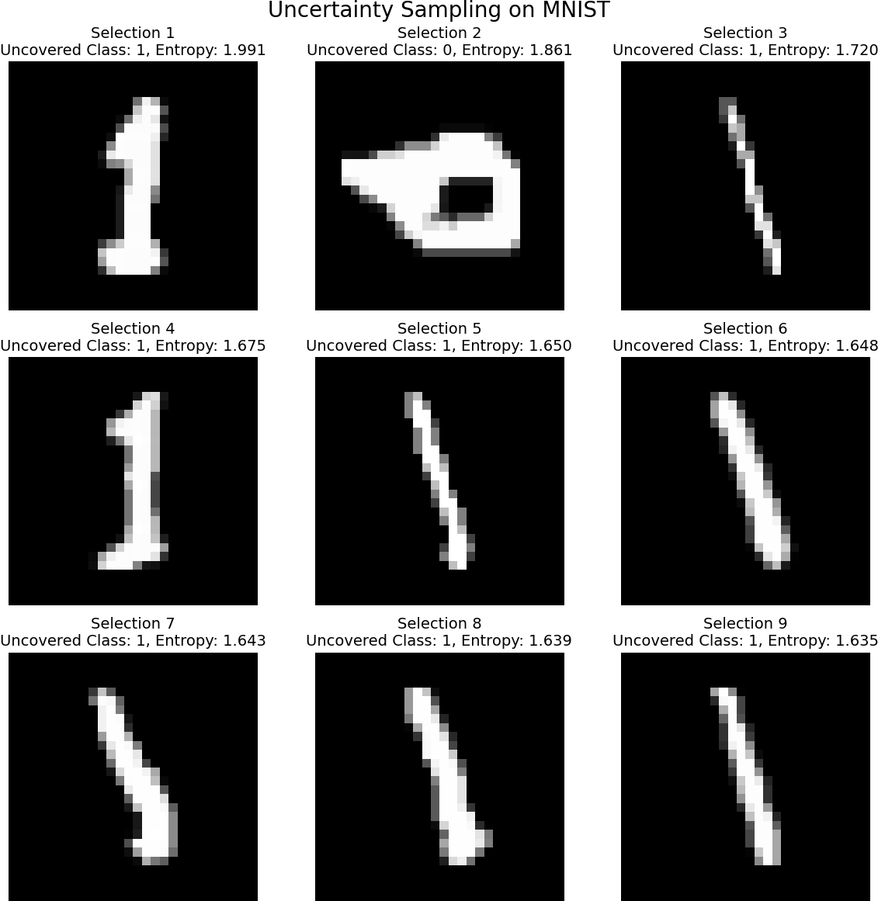
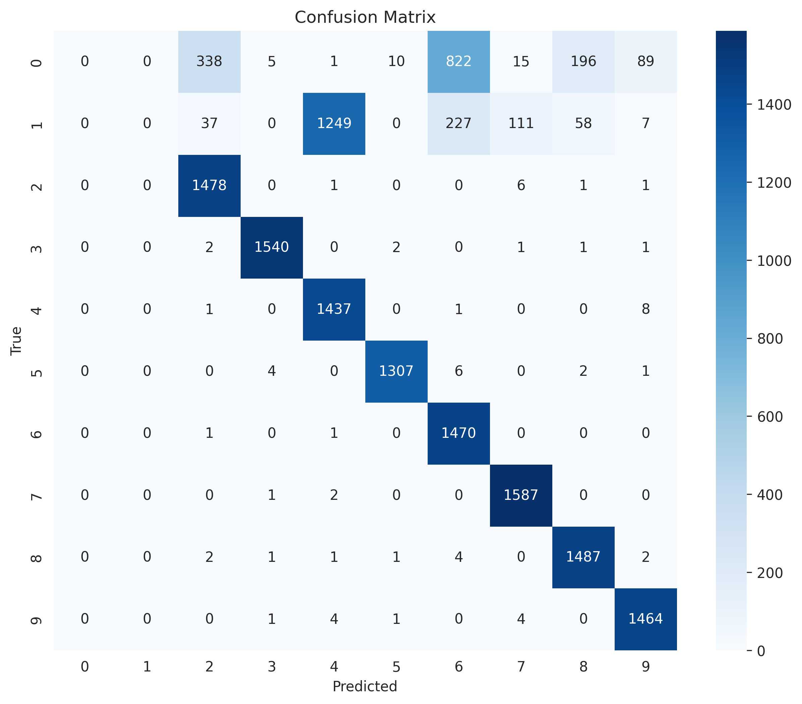
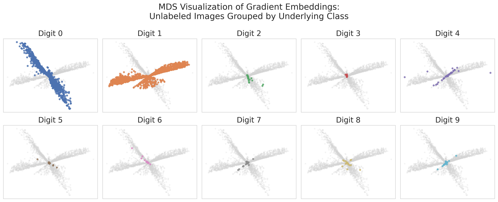
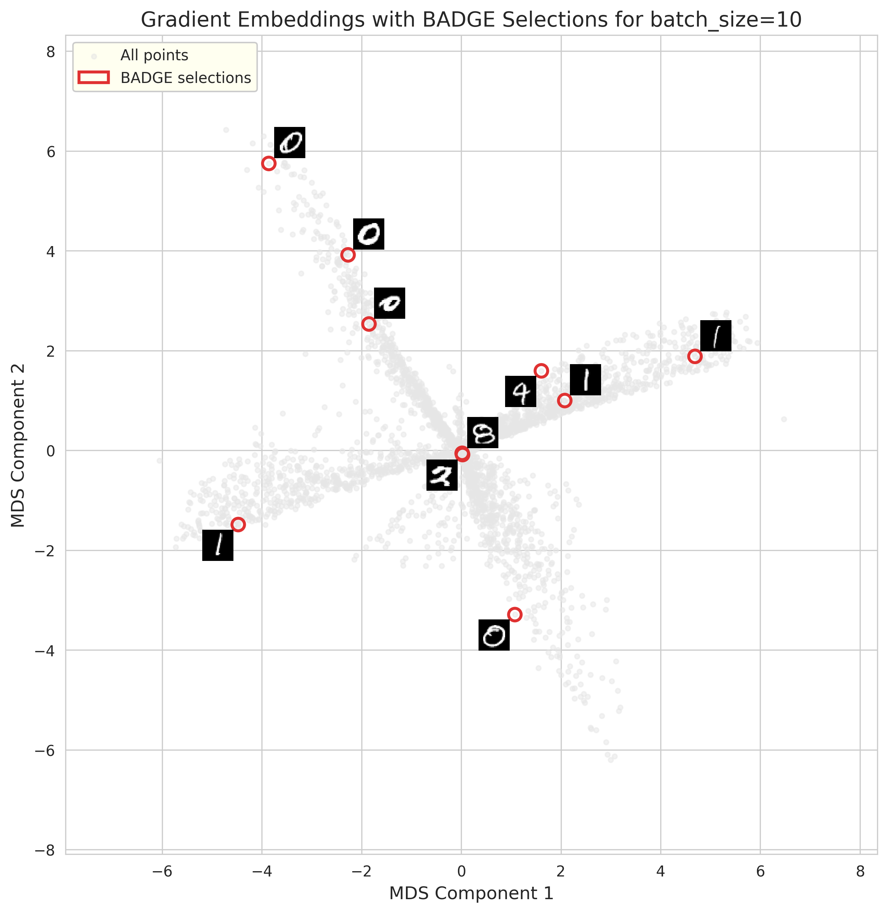

[Batch Active learning by Diverse Gradient Embeddings (BADGE)](https://arxiv.org/abs/1906.03671) is a simple and effective batch-based [active learning](https://en.wikipedia.org/wiki/Active_learning_(machine_learning)) method for neural networks that has been shown empirically to outperform other active learning approaches in a variety of settings.

BADGE selects data points by examining their gradient embeddings—vectors that capture both the model's uncertainty (through the gradient's magnitude) and the data's semantic content (through the gradient's direction). By choosing points with diverse, high-magnitude gradients, BADGE finds samples that are both informative (the model is uncertain about them) and representative of different regions of the input space.[^uncertainty] This helps the model learn efficiently, because each batch focuses on challenging examples while still covering the data distribution well.

[^uncertainty]: [Uncertainty sampling](https://lilianweng.github.io/posts/2022-02-20-active-learning/#uncertainty-sampling) is a common classical active learning strategy that only uses the model's uncertainty to select points for labeling.
    In a batch setting, this can degenerate into selecting points that are all very similar, which wastes much of the labeling budget. Take this example on MNIST, where uncertainty sampling selects eight similar-looking `1`s in a batch of nine:
    

One limitation of BADGE is that it requires the user to specify the batch size in advance. This can be a problem in practice, since we often don't know ahead of time how many data points will get labeled before the next training run. In this post, I'll show how BADGE can be extended to produce a priority ordering over the unlabeled pool, so that it supports variable-sized batches and we can take as many or as few points as we need each round.

## BADGE Overview

Before we get into the extension, let's review how BADGE works. BADGE selects a batch of unlabeled data points that are likely to produce large, diverse gradients once they are labeled. The algorithm proceeds in two steps:

### 1. Compute Gradient Embeddings
First, we compute the gradients of the loss with respect to the final layer of the neural network. These gradients capture both the model's uncertainty (through their magnitude) and the data's semantic content (through their direction).

The first issue that arises is that we don't have true labels for these data points. That's the whole point: our overall goal is to solicit labels for the most informative *unlabeled* data. So in order to compute the gradients, we need to "hallucinate" a label for each unlabeled point. BADGE does this by using the current model to predict the most likely label for each point, then computing the gradient as if that prediction were the ground truth.[^hallucinate]

[^hallucinate]: Using the model's predicted label provides a lower bound on the true gradient magnitude, since no other label has higher predicted probability under the model, so the true label will produce at least as large a gradient.

BADGE uses the gradient with respect to the weights of the final linear layer, which can be computed efficiently without backpropagating through the entire network—a forward pass gives us everything we need. For cross-entropy loss, that gradient is the outer product of the final-layer activations and the difference between the predicted probabilities and the hallucinated one-hot label:

<figure class="fullwidth">
  
</figure>

Here is a reference implementation for computing the gradient embedding of a data point:

```python
import torch
from torch import Tensor, nn
from torch.nn import functional as F


@torch.no_grad()
def compute_gradient_embedding(model: nn.Module, data_point: Tensor) -> Tensor:
    """
    Compute gradient embedding by taking the gradient of cross-entropy loss
    with respect to the final layer weights, using a hallucinated label.

    Args:
        model: A trained neural network model
        data_point: Input tensor of shape [*feature_dims]

    Returns:
        Gradient embedding tensor of shape [hidden_dim * num_classes]
    """
    model.eval()
    x = data_point.unsqueeze(0)  # add batch dimension

    # Compute the output and final layer activations of the model
    logits, final_acts = model(x)
    probs = F.softmax(logits, dim=1)

    # Use predicted class to simulate what gradient would be if this were the true label
    hallucinated_class = logits.argmax(dim=1)
    y_hat = F.one_hot(hallucinated_class, num_classes=logits.shape[1]).float()

    # Compute gradient of cross-entropy loss w.r.t. logits: (prediction - target)
    loss_gradient = (probs - y_hat).squeeze(0)  # [num_classes]

    # Compute gradient embedding by outer product of:
    # - final_acts: the last layer's activations (semantic information)
    # - loss_gradient: the gradient of loss w.r.t. logits (uncertainty)
    # This is equivalent to the gradient w.r.t. the final layer weights
    grad_embedding = torch.outer(
        final_acts.squeeze(0),  # [hidden_dim]
        loss_gradient,  # [num_classes]
    ).flatten()  # [hidden_dim * num_classes]

    return grad_embedding
```

### 2. Select Diverse and Informative Points
Finally, BADGE selects the next batch of data points by choosing points whose gradient embeddings are as diverse as possible. To do this, it uses [k-means++ initialization](https://theory.stanford.edu/~sergei/papers/kMeansPP-soda.pdf), a greedy algorithm originally designed for seeding k-means clustering.[^dpp] The core idea of k-means++ is to iteratively select points that are far away from the points already chosen.

[^dpp]: It's worth noting the connection between k-means++ and [Determinantal Point Processes (DPPs)](https://en.wikipedia.org/wiki/Determinantal_point_process). DPPs are probabilistic models that assign higher probability to diverse subsets of items, and the BADGE authors use them to motivate this step. Sampling exactly from a DPP can be computationally expensive for large pools, so k-means++ serves as a fast, greedy stand-in that still favors subsets whose gradient embeddings are far apart from one another.

The k-means++ algorithm proceeds as follows:
1. Initialize the first point by selecting one uniformly at random from the unlabeled pool.
2. For each subsequent point to be selected, compute the squared Euclidean distance from each unlabeled point to the nearest point that has already been selected.
3. Select the next point with a probability proportional to this squared distance. Specifically, if \(S\) is the set of already-selected points and \(\mathbf{g}(x)\) is the gradient embedding of \(x\), each point \(x_i\) in the unlabeled pool \(U\) has squared distance \(d^2(x_i, S) = \min_{x_j \in S} \|\mathbf{g}(x_i) - \mathbf{g}(x_j)\|^2\) and is selected with probability \(\frac{d^2(x_i, S)}{\sum_{x_j \in U} d^2(x_j, S)}\).
4. Repeat steps 2 and 3 until the desired number of points have been selected.

Given a batch size of \(k\), BADGE uses k-means++ to greedily select \(k\) diverse points from the unlabeled pool based on their gradient embeddings.

The nice thing about k-means++ is that it efficiently picks out a set of points that are well spread out in gradient-embedding space. Because it favors points that are far from the ones already selected, near-duplicates of an earlier selection have very little chance of being picked. That matters for active learning: we want each newly labeled batch to cover a broad range of the data distribution, so that the model learns something new from every label. There's also a nice side effect. Examples where the model is confident have small gradient embeddings that sit near the origin, so the tendency to select far-away points *implicitly favors points with higher-magnitude embeddings*—the ones the model is most uncertain about.

Scikit-learn provides [an implementation](https://scikit-learn.org/stable/modules/generated/sklearn.cluster.kmeans_plusplus.html) of k-means++ for initializing cluster centroids, which can be readily adapted for BADGE.

### A Demonstration with MNIST
Let's see how BADGE works in practice on the [MNIST dataset](https://huggingface.co/datasets/ylecun/mnist). We randomly sample half of MNIST as our training set, then drop every `0` and `1` from it. Leaving out two digit classes gives the model some obvious blind spots, which makes it easier to see whether BADGE collects useful examples.
We then train a simple convolutional neural network on this training set[^confusion] and use BADGE to select the next batch of data points to label from a large pool of unlabeled data.

[^confusion]: The confusion matrix shows that the model consistently misclassifies `0`s and `1`s, as expected since these classes were excluded from training.
    `0`s are most often misclassified as `6`s, while `1`s are most often misclassified as `4`s.
    

We compute gradient embeddings for a held-out set of 15,000 unlabeled points and use [Multidimensional Scaling (MDS)](https://scikit-learn.org/stable/auto_examples/manifold/plot_compare_methods.html#multidimensional-scaling)[^MDS] to reduce the dimensionality of the embeddings to 2D for visualization.
The points are plotted below, with one panel for each true digit class:

[^MDS]: Multidimensional Scaling (MDS) is a technique for visualizing high-dimensional data in a lower-dimensional space. What makes it useful here is that it approximately preserves the pairwise distances between points from the original space. Technically, we use a variant called [Landmark MDS](https://cannoodt.dev/2019/11/lmds-landmark-multi-dimensional-scaling/), which scales better to large datasets.



Notably, the magnitudes of the gradient embeddings are not uniform across the classes. The `0`s and `1`s extend out into long arms away from `(0, 0)`, while the eight classes that the model saw during training stay clustered tightly near `(0, 0)`.[^density] This is expected: the model saw no examples of `0`s or `1`s during training, so it is much more uncertain about them. The plot also shows that the gradient embeddings capture semantic information, since points from the same digit class tend to cluster together. The `0`s and `1`s, for example, stretch along different arms rather than mixing together.

[^density]: It is a bit hard to tell from the scatter plot, but >95% of the 15,000 plotted data points are concentrated in a tight cluster around (0, 0).

We then use k-means++ to sample the next batch of data points to label. For a batch of size 10, the selected points are highlighted below:



As expected, BADGE mostly selects examples from the `0` and `1` classes—the classes that were absent from the training data and that the model is most uncertain about. Within these classes, BADGE picks points with diverse gradient embeddings, so the batch covers different parts of the `0` and `1` arms instead of piling up near-duplicates (in contrast to uncertainty sampling, as we saw above). Intuitively, we hope this diversity will help the model generalize better to the previously unseen digits.

## Extending BADGE to Variable-Sized Batches
While standard BADGE is effective, its requirement for a fixed batch size can be limiting in practice. Consider situations where labeling capacity fluctuates, or where the right number of data points to label before retraining changes from round to round.
In these cases, sticking to a fixed batch size can waste labeling time or budget.
To address this, we introduce a priority ordering over the entire set of unlabeled data points for a given labeling round.
Instead of selecting a fixed batch up front, we can use this ordering to see which points would be most valuable to label first,
second, third, and so on (and then recompute the ordering once we retrain the model). That lets us stay flexible about how many points we ultimately select.

### When Are Variable-Sized Batches Helpful?

Variable-sized batches help whenever the number of labels we can collect depends on real-world timing or budget rather than on a number chosen in advance. Let's look at a few practical scenarios:

#### 1. Keeping Labelers Busy
Consider a team of full-time data labelers who need a steady stream of work. In settings where model training and evaluation are quick compared to labeling time, the number of examples we want before each model update can vary widely—perhaps anywhere from 10 to 10,000 examples.
With variable-sized batches, labelers can keep working through a ranked queue without waiting for the next batch, and we can retrain whenever enough new labels are ready.

#### 2. Changing Budgets and Service Limits
Labeling budgets and other constraints often change over the course of a project:

| Constraint Type     | Example Scenario                                                                    |
| ------------------- | ----------------------------------------------------------------------------------- |
| Budget Changes      | Labeling budgets may be adjusted mid-project                                        |
| Service Limitations | Third-party labeling services often bill by time or cost rather than by batch size  |
| Priority Shifts     | Project priorities may change and cut a labeling round short                        |

Variable-sized batches give us the flexibility to adapt to these changes without sacrificing the quality of the selected examples. If a round gets cut short, the points labeled so far are still a well-spread, high-uncertainty subset; if the budget grows, we simply keep going down the list.

#### 3. Online Active Learning
In [online learning](https://en.wikipedia.org/wiki/Online_machine_learning) scenarios, data arrives sequentially, and models need to be updated incrementally.
Variable-sized batches are a natural fit for this setting. Instead of waiting for a fixed number of new labels to become available,
we can update the model as soon as enough high-priority examples have been labeled. That way, the model can adapt
more quickly to changes in the data distribution and make use of new information as it arrives, which can lead to faster convergence
and better performance over time. More on this below.

### Generating a Prioritized Ordering

As mentioned earlier, the key to supporting variable-sized batches in BADGE is to generate a priority ordering over the entire set of unlabeled data points.

It turns out that k-means++ gives us this ordering almost for free! Under the hood, k-means++ *already* selects diverse, informative points one at a time; standard BADGE just lumps them into an unordered batch at the end. So if we run k-means++ on the whole unlabeled pool and simply record the order of selection, we get a ranked list in which earlier points tend to be both more informative and well spread out across the embedding space.
We can then work through this priority queue of points, stopping whenever we've reached our desired batch size.

This approach also lends itself well to online active learning, where new unlabeled data points may become available over time. Because the ordering is built one point at a time, we can keep selecting the most valuable points for labeling as new data shows up.

### Demonstrating on MNIST (Continued from above)

To demonstrate this extension, we use the same setup as before, but this time we run k-means++ on the entire pool of unlabeled data points to generate an ordering. We then select the next data point to label by following this ordering.

We visualize the ordering generated by k-means++ below:

<p>
    <video controls autoplay loop muted playsinline preload="none" loading="lazy">
    <source src="/assets/img/badge_selection_order.webm" type="video/webm">
    Your browser does not support the video tag.
    </video>
</p>


### Computing K-means++ Ordering Efficiently
The time complexity of k-means++ initialization is \(O(nkd)\), where \(n\) is the number of data points, \(k\) is the number of centroids to select,
and \(d\) is the dimensionality of the data. The \(d\) factor comes from computing distances between points in \(d\)-dimensional space.
When we generate a complete ordering over the pool of unlabeled data points, we are effectively running k-means++ with \(k = n\).
That means the overall time complexity is \(O(n^2 d)\), which can get slow for large pools or high-dimensional embeddings, especially on a CPU.

However, we can speed this process up significantly by running the distance computations on a GPU:

```python
import torch


@torch.no_grad()
def kmeans_pp_pytorch(data: torch.Tensor, k: int = -1) -> torch.Tensor:
    """
    K-means++ implementation.
    Leverages a GPU if available, which significantly speeds up computation.
    """
    device = torch.device("cuda" if torch.cuda.is_available() else "cpu")
    data = data.to(device)
    n_samples = data.shape[0]
    if k == -1:
        k = n_samples

    # Initialize output indices and running minimum squared distances
    selected_indices = torch.zeros(k, dtype=torch.long, device=device)
    min_squared_distances = torch.full((n_samples,), float("inf"), device=device)

    # Pick first point randomly
    selected_indices[0] = torch.randint(n_samples, (1,), device=device)
    min_squared_distances[selected_indices[0]] = 0.0

    # Process remaining points
    for i in range(1, k):
        # Compute squared distances to the most recently selected center
        last_center = data[selected_indices[i - 1]].unsqueeze(0)
        new_squared_distances = torch.cdist(data, last_center, p=2).square().squeeze(1)

        # Update minimum squared distance to any selected center for each point
        min_squared_distances = torch.minimum(
            min_squared_distances, new_squared_distances
        )

        # Sample next center with probability proportional to squared distance
        if min_squared_distances.sum() > 0:
            next_idx = torch.multinomial(min_squared_distances, num_samples=1)
        else:
            # Remaining points coincide with existing centers; pick any unselected point
            unselected = torch.ones(n_samples, dtype=torch.bool, device=device)
            unselected[selected_indices[:i]] = False
            next_idx = unselected.nonzero()[0]

        selected_indices[i] = next_idx
        min_squared_distances[next_idx] = 0.0

    return selected_indices
```

This GPU-accelerated implementation makes a big difference. For a dataset of 15,000 embeddings with 2,560 dimensions,
it generates a complete ordering in just 20 seconds, compared to 15 minutes using scikit-learn's CPU implementation.

Additionally, since data labeling is time-consuming, we can optimize further by *extracting points from the ordering one at a time* (and only as needed)
rather than computing the entire ordering up front. With this lazy approach, we can stop once we've labeled our desired
number of points and never compute the rest of the ordering. It also lets us add new (and potentially useful) data points to the pool
of unlabeled data on the fly as those points become available! See [this (longer) code snippet](https://gist.github.com/tyler-romero/1aba44c529c64fb3c29026ec906bcd9c) for an example of how to lazily generate the ordering.

## Can Other Popular Batch Active Learning Methods Be Similarly Extended?
Not all batch active learning methods can be turned into a pool-wide ranking. For this trick to work, a method needs to select points greedily, one at a time, and each step needs to stay cheap and informative even as the list grows long.
Let's consider two categories of batch active learning methods and discuss how well they extend:

### Yes: CORESET and other Greedy-Selection Algorithms

[CORESET](https://arxiv.org/abs/1708.00489) is a batch active learning method that treats selection as a core-set problem: it aims to pick a set of points that covers the feature space. Its greedy version builds the batch by repeatedly choosing the point that is farthest from everything already labeled or selected. Like BADGE, greedy CORESET can be extended to generate a priority ordering over the unlabeled pool.

The extension is straightforward: instead of stopping after selecting \(k\) points, run greedy
CORESET until all unlabeled points are ordered. Starting from the existing labeled set (or a random initial point if we have no labels yet),
each iteration adds the unlabeled point whose distance to its nearest already-labeled or already-selected neighbor is largest.

This naturally prioritizes points in unexplored regions of the feature space—earlier points fill the biggest gaps, and later points fill smaller ones.
This ordering preserves CORESET's goal of covering the space evenly, and any prefix of it is still a well-spread subset, whatever batch size we end up with.

### No: BatchBALD and Global Batch Methods

At first glance, [BatchBALD](https://arxiv.org/abs/1906.08158) looks like it should scale the same way, since it also builds its batch greedily, one point at a time. At each step, BatchBALD adds the point that maximizes the joint mutual information between the batch's predicted labels and the Bayesian model parameters. That greedy prefix works fine for small variable-sized batches, but two practical limits keep it from scaling to a full-pool ranking.

First, computing the exact joint predictive entropy across \(k\) points with \(C\) classes requires summing over \(C^k\) possible label combinations. Exact enumeration becomes intractable after only a handful of points, and the Monte Carlo approximations that replace it grow noisier and heavier as \(k\) gets large. Second, BatchBALD approximates the model posterior with \(M\) parameter samples (MC dropout draws, for example), and the true mutual information under that discrete posterior is bounded above by \(\log M\). Once the batch's joint labels nearly identify which of the \(M\) parameter samples generated them, marginal information gains flatten out and later selections stop being as meaningful.

Methods that choose or sample a whole batch of size \(k\) at once have a more fundamental problem: they don't produce a single ranking at all. In global optimization methods like the mixed-integer program for exact CORESET, the best batch of size \(k\) doesn't have to contain the best batch of size \(k - 1\). Similarly, exact \(k\)-DPP sampling draws a joint subset whose distribution depends on \(k\) from the start, rather than adding one point at a time.

In short, greedy methods like BADGE and greedy CORESET extend cleanly to full-pool rankings because each greedy step stays fast and keeps selecting informative points as \(k\) grows, whereas BatchBALD runs into scaling limits on long rankings and non-greedy methods don't define a nested ordering at all.

## Thanks for Reading!
If you're building something interesting with these methods or want to chat more about active learning, I'd love to [hear from you](mailto:tyler.alexander.romero@gmail.com)!

## References
<textarea id="bibtex_input" style="display:none;">
@misc{ash2020deep,
      title={Deep Batch Active Learning by Diverse, Uncertain Gradient Lower Bounds},
      author={Jordan T. Ash and Chicheng Zhang and Akshay Krishnamurthy and John Langford and Alekh Agarwal},
      year={2020},
      eprint={1906.03671},
      archivePrefix={arXiv},
      primaryClass={cs.LG},
      url={https://arxiv.org/abs/1906.03671}
}
@misc{lecun1998mnist,
      author={Yann LeCun and Corinna Cortes and Christopher J. C. Burges},
      title={The MNIST Database of Handwritten Digits},
      year={1998},
      url={http://yann.lecun.com/exdb/mnist/}
}
@techreport{desilva2004sparse,
      author={de Silva, Vin and Tenenbaum, Joshua B.},
      title={Sparse Multidimensional Scaling using Landmark Points},
      year={2004},
      institution={Stanford University},
      url={https://graphics.stanford.edu/courses/cs468-05-winter/Papers/Landmarks/Silva_landmarks5.pdf}
}
@inproceedings{sener2018active,
      title={Active Learning for Convolutional Neural Networks: A Core-Set Approach},
      author={Ozan Sener and Silvio Savarese},
      year={2018},
      booktitle={International Conference on Learning Representations},
      eprint={1708.00489},
      archivePrefix={arXiv},
      primaryClass={cs.LG},
      url={https://arxiv.org/abs/1708.00489}
}
@inproceedings{kirsch2019batchbald,
      title={BatchBALD: Efficient and Diverse Batch Acquisition for Deep Bayesian Active Learning},
      author={Andreas Kirsch and Joost van Amersfoort and Yarin Gal},
      year={2019},
      booktitle={Advances in Neural Information Processing Systems},
      eprint={1906.08158},
      archivePrefix={arXiv},
      primaryClass={cs.LG},
      url={https://arxiv.org/abs/1906.08158}
}
@software{motta2019lmds,
      author={Danilo Motta},
      title={MDS and LMDS implementation},
      year={2019},
      url={https://github.com/danilomotta/LMDS},
      note={GitHub repository}
}
@software{demoriarty2024fast,
      author={De Moriarty, A.},
      title={fast\_pytorch\_kmeans},
      year={2024},
      url={https://github.com/DeMoriarty/fast_pytorch_kmeans},
      note={GitHub repository}
}
</textarea>
